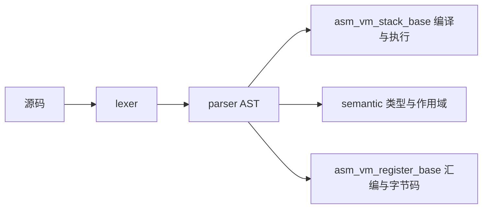

# compiler

用 Go 实现的教学语言 **sans** 编译器。模块名是 `go-compiler`，语言版本见 [go.mod](go.mod)（Go 1.21）。

入口 [main.go](main.go) 启动交互环境，提示语是 “sans programming language”。REPL 先做语义分析，再走栈式虚拟机：词法分析、语法分析、类型检查、编译成字节码并执行，打印栈顶结果。寄存器后端仍只在测试里调用。

## 目录

| 目录 | 作用 |
| --- | --- |
| [lexer/](lexer/) | 把源码切成 token |
| [parser/](parser/) | 递归下降，生成 AST |
| [semantic/](semantic/) | 作用域与类型检查 |
| [asm_vm_stack_base/](asm_vm_stack_base/) | 栈式字节码编译器与虚拟机，REPL 使用这条路径 |
| [asm_vm_register_base/](asm_vm_register_base/) | 寄存器汇编生成，以及汇编到 `[]int64` 的汇编器 |
| [repl/](repl/) | 逐行读取、编译、执行 |
| [utils/](utils/) | 日志 |

## 流水线



REPL（[repl/repl.go](repl/repl.go)）的实际路径是：源码 → 词法 → 语法 → 语义分析 → 栈式编译 → 虚拟机，然后把栈顶值写到标准输出。花括号还没配平时会继续读下一行。作用域、符号表和全局变量会留给后面的输入。

寄存器后端（[asm_vm_register_base/](asm_vm_register_base/)）从同一份 AST 出发，调用点在它自己的测试里。

## 运行

```bash
go run .
go test ./...
```

`go run .` 进入 REPL，提示符是 `>>`。类体或函数体可以分多行输入，未闭合的 `{` 会换成 `.. ` 继续读。语义错误会打印出来，这一段不会执行。

栈式虚拟机的行为以 [asm_vm_stack_base/vm_test.go](asm_vm_stack_base/vm_test.go) 和 [asm_vm_stack_base/compiler_test.go](asm_vm_stack_base/compiler_test.go) 为准。语义分析和寄存器代码生成的测试目前以打印 AST、符号表或汇编为主。

## 词法分析

扫描器是 [lexer/lexer.go](lexer/lexer.go) 里的 `SansLangLexer`，token 种类定义在 [lexer/token_type.go](lexer/token_type.go)。

关键字：

`or` `and` `not` `class` `while` `for` `break` `continue` `var` `const` `function` `return` `null` `super` `cls` `this` `new`

字面量：

- 数字：整数和小数，例如 `0`、`42`、`1.5`
- 布尔：`true`、`false`
- 字符串：双引号、单引号、反引号。反引号字符串可以跨行。转义包括 `\'` `\"` `\\` `\b` `\f` `\n` `\r` `\t` `\v`
- `null`

已扫描的符号：

`+` `-` `*` `/` `%`、`+=` `-=` `*=` `/=`、`=` `==` `!=`、`<` `>` `<=` `>=`、`(` `)` `{` `}` `[` `]`、`.` `,` `:` `;`

`//` 到行尾是注释，会被跳过。标识符由字母或下划线开头，后面可以跟数字。

移位（`>>` `<<`）和位运算（`&` `|` `~`）登记在 token 类型表里。扫描循环没有对应分支，源码里写这些符号时不会得到对应 token。

## 语法分析

解析器是 [parser/parser.go](parser/parser.go) 里的递归下降 `SansLangParser`。节点定义在 [parser/ast.go](parser/ast.go)，节点名在 [parser/ast_type.go](parser/ast_type.go)。一整个程序是 `Program`，`Body` 是语句列表。

声明：

```sans
var a = 1
const name = "sans"
```

语句：表达式语句、`{ ... }` 块、`return`、`if` / `else if` / `else`、`while`、`for (init; test; update)`、`break`、`continue`。

```sans
var i = 0
for (i = 0; i < 4; i = i + 2) {
    if (i == 0) {
        continue
    }
    if (i == 2) {
        break
    }
}
```

表达式由低到高大致是：复合赋值（`+=` `-=` `*=` `/=`）、赋值（`=`）、`and` / `or`、`==` / `!=`、比较、`+` / `-`、`*` / `/` / `%`、一元 `not` 和负号，再往下是调用、成员访问和字面量。调用写成 `f(1, 2)`，成员访问支持 `obj.field` 和 `arr[i]`。

函数是表达式：

```sans
const sum = function(a, b) {
    return a + b
}
sum(1, 2)
```

数组和字典：

```sans
var xs = [1, 2, 3]
var obj = {"k": 1}
xs[0]
obj["k"]
```

类可以被解析。父类写在类名后面，类体里用 `const` 声明字段和方法，`cls.` 表示类成员，`new` 是构造函数：

```sans
class B {
    const new = function() {
    }
}
class A super B {
    const cls.age = 1
    const new = function(name) {
        this.name = name
    }
    const cls.fuck = function() {
        return 1
    }
}
var a = A.new()
```

注释里还列了 `<<` `>>`、位与、位或，以及 `===`。这些分支没有接上扫描器和解析循环。

## 语义分析

[semantic/semantic_analysis_v2.go](semantic/semantic_analysis_v2.go) 的 `SemanticAnalysisV2` 遍历 AST。[semantic/scope_symbo_v2.go](semantic/scope_symbo_v2.go) 用链式 `ScopeV2` 保存符号，查找时会沿父作用域向上找。

类型定义在 [semantic/value_type_v2.go](semantic/value_type_v2.go)：`NumberType`、`StringType`、`BooleanType`、`NullType`、`ArrayType`、`DictType`、`FunctionType`、`ClassType`、`InstanceType`，推断失败时是 `UnKnownType`。`void` 也有对应类型。每个符号记下名字、类型、是否静态，以及 `var` / `const`。

访问时会做这些检查：

- 使用未声明的变量会报错
- `const` 不能再赋值
- 已声明变量再赋值时，右侧类型要和原类型一致；推断不出类型时保留原类型
- 函数记录参数和返回类型；同名函数或类不能重复声明
- 类必须有 `new`；写了 `super` 时要能在作用域里找到父类

示例输入在 [semantic/semantic_analysis_v2_test.go](semantic/semantic_analysis_v2_test.go)，覆盖基本类型、逻辑运算、循环、函数和类。`TestSemanticAnalysisV2` 里这些用例默认是注释掉的，需要手动打开对应的 `testSemanticAnalysis*` 才会跑。

REPL 在编译前会调用 `Visit`。语义错误沿用 `utils.LogError` 的 panic，REPL 接住后打印并继续下一轮。

## 两条后端

### 栈式虚拟机

REPL 使用 [asm_vm_stack_base/](asm_vm_stack_base/)。[compiler.go](asm_vm_stack_base/compiler.go) 把 AST 编成字节码和常量池，[vm.go](asm_vm_stack_base/vm.go) 解释执行。指令在 [op_code.go](asm_vm_stack_base/op_code.go)，包括常量、四则运算、比较、条件跳转、全局/局部变量、数组、字典、函数调用、闭包和自由变量。

运行时值在 [value.go](asm_vm_stack_base/value.go)：数字、布尔、字符串、`null`、数组、字典，以及函数和内置函数对象。

测试覆盖的行为：

- 算术、一元负号、`not`、比较
- `var` / `const`、全局变量和函数内局部变量
- 字符串拼接
- 数组、字典、下标
- `if`、`while`、`for`，以及循环里的 `break` / `continue`
- 函数、嵌套函数、闭包、递归
- 复合赋值，例如 `a *= 1`、`a += "12"`

内置函数在 [builtins.go](asm_vm_stack_base/builtins.go)：

| 名字 | 作用 |
| --- | --- |
| `len` | 数组或字符串的长度 |
| `log` | 打印参数，结果是 `null` |
| `push` | 在数组末尾追加一个元素，返回新数组 |

类在这条虚拟机上可以执行。`class A super B` 继承父类的 `cls` 成员，子类同名成员覆盖父类。`A.new(...)` 创建实例并调用 `new`，返回实例。`this.field = ...` 写实例字段。`obj.method()` 把实例绑定为 `this`。

纯数字函数可以再收成一套更短的自有指令，定义和执行在 [jit_num.go](asm_vm_stack_base/jit_num.go)。指令只有加载数字常量、读写局部变量、加减乘除、取负、丢弃栈顶和返回，操作数是 `float64`。`VM.JitEnabled` 默认关闭。打开后，`callFunctionClosure` 会尝试编译被调用的函数；字节码里一旦出现比较、跳转、调用或属性访问，就整段留在原来的解释器里。这不是 CPU 机器码，仍然由 Go 循环执行。测试见 [jit_test.go](asm_vm_stack_base/jit_test.go)。

### 寄存器后端

[asm_vm_register_base/](asm_vm_register_base/) 是另一条代码生成路径，没有接到 REPL。

[ast_to_asm.go](asm_vm_register_base/ast_to_asm.go) 的 `CodeGenerator` 遍历 AST，写出汇编文本，并用寄存器和栈偏移安排操作数。它处理字面量、算术、比较、`if` / `while` / `for`、函数和调用。

[asm_to_bytecode.go](asm_vm_register_base/asm_to_bytecode.go) 的 `Assembler` 把汇编收成 `[]int64`。指令表在 [instruction.go](asm_vm_register_base/instruction.go)，主体是 16 位运算：`set2`、`add2`、`sub2`、`mul2`、`div2`、比较、`jump`、`push` / `pop`，以及伪指令 `.function`、`.return`、`.func_var`。

[vm.go](asm_vm_register_base/vm.go) 能执行 `set2`、加减乘除和 `halt`。跳转、比较、函数和内存访问还没跑，这条路径也还没接到 REPL。

## TODO

- 寄存器后端只执行算术指令，跳转、比较、函数还没跑，也没接到 REPL
- 数字快路径只覆盖算术和局部变量，不生成 CPU 机器码
- 优化，例如常量折叠
